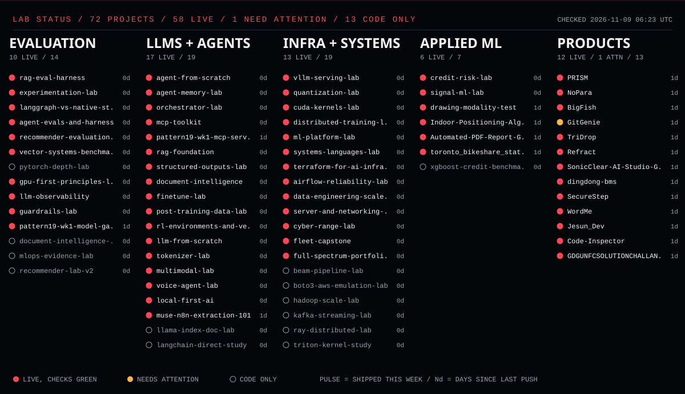

AI engineer in Toronto. Production ML, retrieval and agent orchestration, each built as a measured study.

## The question

How far can we trust the judge?

That is the question under this work. The research spine is evaluation reliability: whether the scores that decisions rest on deserve the trust placed in them. The roadmap below asks that question twenty-nine ways, in the open.

## Judge the judge

The judge below is the embedding judge from [rag-eval-harness](https://github.com/JesunAhmadUshno/rag-eval-harness). It has graded hundreds of answers and has never been checked against people. You are the check: read the case, then say whether the judge got it right. Your vote is recorded in this repository and the numbers below update within a minute.

<!--PROFILE:JUDGE-->
**Case 7 of 30** · a new case every day

> **Question:** Where was the Continental Edison Company located? 
> **Reference answer:** France 
> **System answered:** Tesla 
> **The judge said:** **FAIL**

Is the judge right? &nbsp; [**Yes, the judge is right**](https://github.com/JesunAhmadUshno/JesunAhmadUshno/issues/new?title=judge%3A%20squad-56e0d54a7aa994140058e76a%20agree&body=Press%20%22Submit%20new%20issue%22%20to%20cast%20this%20vote.%20A%20bot%20records%20it%20within%20a%20minute%2C%20replies%20with%20the%20running%20tally%2C%20and%20closes%20the%20issue.) &nbsp;·&nbsp; [**No, the judge is wrong**](https://github.com/JesunAhmadUshno/JesunAhmadUshno/issues/new?title=judge%3A%20squad-56e0d54a7aa994140058e76a%20disagree&body=Press%20%22Submit%20new%20issue%22%20to%20cast%20this%20vote.%20A%20bot%20records%20it%20within%20a%20minute%2C%20replies%20with%20the%20running%20tally%2C%20and%20closes%20the%20issue.)

This case so far: 0 agree, 0 disagree.

**Across all cases:** no votes yet. The first vote starts the record.

Cases: 30 fixed SQuAD items (15 the judge passed, 15 it failed, chosen by id hash) from [real-data/results_real.json](https://github.com/JesunAhmadUshno/rag-eval-harness/blob/974bed06ffee334ee96553ec8bc27adadc32fd63/real-data/results_real.json) at `974bed0`. Judge: embedding judge, minishlab/potion-base-8M. Votes live in [data/votes.json](data/votes.json), one per GitHub account per case.
<!--/PROFILE:JUDGE-->

## The lab

Every public project, checked every morning: is the live site answering, are the repository's own checks passing, and when was it last shipped.

<!--PROFILE:BOARD-->

<b>Evaluation</b> · 10 of 14 live

| Project | Live | Site | Checks | Updated |
| :--- | :--- | :--- | :--- | :--- |
| 🟢 [rag-eval-harness](https://github.com/JesunAhmadUshno/rag-eval-harness) | [open](https://jesunahmadushno.github.io/rag-eval-harness/) | 🟢 up | 🟢 10/10 | 2026-11-09 |
| 🟢 [experimentation-lab](https://github.com/JesunAhmadUshno/experimentation-lab) | [open](https://jesunahmadushno.github.io/experimentation-lab/) | 🟢 up | 🟢 14/14 | 2026-11-09 |
| 🟢 [langgraph-vs-native-study](https://github.com/JesunAhmadUshno/langgraph-vs-native-study) | [open](https://jesunahmadushno.github.io/langgraph-vs-native-study/) | 🟢 up | 🟢 9/9 | 2026-11-09 |
| 🟢 [agent-evals-and-harness](https://github.com/JesunAhmadUshno/agent-evals-and-harness) | [open](https://jesunahmadushno.github.io/agent-evals-and-harness/) | 🟢 up | 🟢 13/13 | 2026-11-09 |
| 🟢 [recommender-evaluation-lab](https://github.com/JesunAhmadUshno/recommender-evaluation-lab) | [open](https://jesunahmadushno.github.io/recommender-evaluation-lab/) | 🟢 up | 🟢 9/9 | 2026-11-08 |
| 🟢 [vector-systems-benchmark](https://github.com/JesunAhmadUshno/vector-systems-benchmark) | [open](https://jesunahmadushno.github.io/vector-systems-benchmark/) | 🟢 up | 🟢 9/9 | 2026-11-09 |
| ⚪ [pytorch-depth-lab](https://github.com/JesunAhmadUshno/pytorch-depth-lab) | · | · | 🟢 6/6 | 2026-11-09 |
| 🟢 [gpu-first-principles-lab](https://github.com/JesunAhmadUshno/gpu-first-principles-lab) | [open](https://jesunahmadushno.github.io/gpu-first-principles-lab/) | 🟢 up | 🟢 9/9 | 2026-11-09 |
| 🟢 [llm-observability](https://github.com/JesunAhmadUshno/llm-observability) | [open](https://jesunahmadushno.github.io/llm-observability/) | 🟢 up | 🟢 15/15 | 2026-11-08 |
| 🟢 [guardrails-lab](https://github.com/JesunAhmadUshno/guardrails-lab) | [open](https://jesunahmadushno.github.io/guardrails-lab/) | 🟢 up | 🟢 13/13 | 2026-11-09 |
| 🟢 [pattern19-wk1-model-gate](https://github.com/JesunAhmadUshno/pattern19-wk1-model-gate) | [open](https://jesunahmadushno.github.io/pattern19-wk1-model-gate/) | 🟢 up | 🟢 1/1 | 2026-11-07 |
| ⚪ [document-intelligence-lab](https://github.com/JesunAhmadUshno/document-intelligence-lab) | · | · | 🟢 4/4 | 2026-11-09 |
| ⚪ [mlops-evidence-lab](https://github.com/JesunAhmadUshno/mlops-evidence-lab) | · | · | 🟢 6/6 | 2026-11-09 |
| ⚪ [recommender-lab-v2](https://github.com/JesunAhmadUshno/recommender-lab-v2) | · | · | 🟢 1/1 | 2026-11-08 |

<b>LLMs + Agents</b> · 17 of 19 live

| Project | Live | Site | Checks | Updated |
| :--- | :--- | :--- | :--- | :--- |
| 🟢 [agent-from-scratch](https://github.com/JesunAhmadUshno/agent-from-scratch) | [open](https://jesunahmadushno.github.io/agent-from-scratch/) | 🟢 up | 🟢 15/15 | 2026-11-09 |
| 🟢 [agent-memory-lab](https://github.com/JesunAhmadUshno/agent-memory-lab) | [open](https://jesunahmadushno.github.io/agent-memory-lab/) | 🟢 up | 🟢 15/15 | 2026-11-09 |
| 🟢 [orchestrator-lab](https://github.com/JesunAhmadUshno/orchestrator-lab) | [open](https://jesunahmadushno.github.io/orchestrator-lab/) | 🟢 up | 🟢 7/7 | 2026-11-09 |
| 🟢 [mcp-toolkit](https://github.com/JesunAhmadUshno/mcp-toolkit) | [open](https://jesunahmadushno.github.io/mcp-toolkit/) | 🟢 up | 🟢 7/7 | 2026-11-09 |
| 🟢 [pattern19-wk1-mcp-server](https://github.com/JesunAhmadUshno/pattern19-wk1-mcp-server) | [open](https://jesunahmadushno.github.io/pattern19-wk1-mcp-server/) | 🟢 up | 🟢 1/1 | 2026-11-07 |
| 🟢 [rag-foundation](https://github.com/JesunAhmadUshno/rag-foundation) | [open](https://jesunahmadushno.github.io/rag-foundation/) | 🟢 up | 🟢 12/12 | 2026-11-09 |
| 🟢 [structured-outputs-lab](https://github.com/JesunAhmadUshno/structured-outputs-lab) | [open](https://jesunahmadushno.github.io/structured-outputs-lab/) | 🟢 up | 🟢 11/11 | 2026-11-09 |
| 🟢 [document-intelligence](https://github.com/JesunAhmadUshno/document-intelligence) | [open](https://jesunahmadushno.github.io/document-intelligence/) | 🟢 up | 🟢 13/13 | 2026-11-09 |
| 🟢 [finetune-lab](https://github.com/JesunAhmadUshno/finetune-lab) | [open](https://jesunahmadushno.github.io/finetune-lab/) | 🟢 up | 🟢 9/9 | 2026-11-09 |
| 🟢 [post-training-data-lab](https://github.com/JesunAhmadUshno/post-training-data-lab) | [open](https://jesunahmadushno.github.io/post-training-data-lab/) | 🟢 up | 🟢 13/13 | 2026-11-09 |
| 🟢 [rl-environments-and-verifiers](https://github.com/JesunAhmadUshno/rl-environments-and-verifiers) | [open](https://jesunahmadushno.github.io/rl-environments-and-verifiers/) | 🟢 up | 🟢 15/15 | 2026-11-09 |
| 🟢 [llm-from-scratch](https://github.com/JesunAhmadUshno/llm-from-scratch) | [open](https://jesunahmadushno.github.io/llm-from-scratch/) | 🟢 up | 🟢 15/15 | 2026-11-09 |
| 🟢 [tokenizer-lab](https://github.com/JesunAhmadUshno/tokenizer-lab) | [open](https://jesunahmadushno.github.io/tokenizer-lab/) | 🟢 up | 🟢 13/13 | 2026-11-09 |
| 🟢 [multimodal-lab](https://github.com/JesunAhmadUshno/multimodal-lab) | [open](https://jesunahmadushno.github.io/multimodal-lab/) | 🟢 up | 🟢 15/15 | 2026-11-09 |
| 🟢 [voice-agent-lab](https://github.com/JesunAhmadUshno/voice-agent-lab) | [open](https://jesunahmadushno.github.io/voice-agent-lab/) | 🟢 up | 🟢 15/15 | 2026-11-09 |
| 🟢 [local-first-ai](https://github.com/JesunAhmadUshno/local-first-ai) | [open](https://jesunahmadushno.github.io/local-first-ai/) | 🟢 up | 🟢 13/13 | 2026-11-08 |
| 🟢 [muse-n8n-extraction-101](https://github.com/JesunAhmadUshno/muse-n8n-extraction-101) | [open](https://jesunahmadushno.github.io/muse-n8n-extraction-101/) | 🟢 up | 🟢 1/1 | 2026-11-07 |
| ⚪ [llama-index-doc-lab](https://github.com/JesunAhmadUshno/llama-index-doc-lab) | · | · | 🟢 4/4 | 2026-11-09 |
| ⚪ [langchain-direct-study](https://github.com/JesunAhmadUshno/langchain-direct-study) | · | · | 🟢 6/6 | 2026-11-09 |

<b>Infra + Systems</b> · 13 of 19 live

| Project | Live | Site | Checks | Updated |
| :--- | :--- | :--- | :--- | :--- |
| 🟢 [vllm-serving-lab](https://github.com/JesunAhmadUshno/vllm-serving-lab) | [open](https://jesunahmadushno.github.io/vllm-serving-lab/) | 🟢 up | 🟢 13/13 | 2026-11-08 |
| 🟢 [quantization-lab](https://github.com/JesunAhmadUshno/quantization-lab) | [open](https://jesunahmadushno.github.io/quantization-lab/) | 🟢 up | 🟢 14/14 | 2026-11-09 |
| 🟢 [cuda-kernels-lab](https://github.com/JesunAhmadUshno/cuda-kernels-lab) | [open](https://jesunahmadushno.github.io/cuda-kernels-lab/) | 🟢 up | 🟢 13/13 | 2026-11-09 |
| 🟢 [distributed-training-lab](https://github.com/JesunAhmadUshno/distributed-training-lab) | [open](https://jesunahmadushno.github.io/distributed-training-lab/) | 🟢 up | 🟢 15/15 | 2026-11-08 |
| 🟢 [ml-platform-lab](https://github.com/JesunAhmadUshno/ml-platform-lab) | [open](https://jesunahmadushno.github.io/ml-platform-lab/) | 🟢 up | 🟢 15/15 | 2026-11-09 |
| 🟢 [systems-languages-lab](https://github.com/JesunAhmadUshno/systems-languages-lab) | [open](https://jesunahmadushno.github.io/systems-languages-lab/) | 🟢 up | 🟢 13/13 | 2026-11-08 |
| 🟢 [terraform-for-ai-infrastructure](https://github.com/JesunAhmadUshno/terraform-for-ai-infrastructure) | [open](https://jesunahmadushno.github.io/terraform-for-ai-infrastructure/) | 🟢 up | 🟢 7/7 | 2026-11-08 |
| 🟢 [airflow-reliability-lab](https://github.com/JesunAhmadUshno/airflow-reliability-lab) | [open](https://jesunahmadushno.github.io/airflow-reliability-lab/) | 🟢 up | 🟢 9/9 | 2026-11-09 |
| 🟢 [data-engineering-scale-lab](https://github.com/JesunAhmadUshno/data-engineering-scale-lab) | [open](https://jesunahmadushno.github.io/data-engineering-scale-lab/) | 🟢 up | 🟢 9/9 | 2026-11-09 |
| 🟢 [server-and-networking-lab](https://github.com/JesunAhmadUshno/server-and-networking-lab) | [open](https://jesunahmadushno.github.io/server-and-networking-lab/) | 🟢 up | 🟢 7/7 | 2026-11-08 |
| 🟢 [cyber-range-lab](https://github.com/JesunAhmadUshno/cyber-range-lab) | [open](https://jesunahmadushno.github.io/cyber-range-lab/) | 🟢 up | 🟢 13/13 | 2026-11-08 |
| 🟢 [fleet-capstone](https://github.com/JesunAhmadUshno/fleet-capstone) | [open](https://jesunahmadushno.github.io/fleet-capstone/) | 🟢 up | 🟢 15/15 | 2026-11-09 |
| 🟢 [full-spectrum-portfolio-index](https://github.com/JesunAhmadUshno/full-spectrum-portfolio-index) | [open](https://jesunahmadushno.github.io/full-spectrum-portfolio-index/) | 🟢 up | 🟢 2/2 | 2026-11-09 |
| ⚪ [beam-pipeline-lab](https://github.com/JesunAhmadUshno/beam-pipeline-lab) | · | · | 🟢 6/6 | 2026-11-09 |
| ⚪ [boto3-aws-emulation-lab](https://github.com/JesunAhmadUshno/boto3-aws-emulation-lab) | · | · | 🟢 6/6 | 2026-11-09 |
| ⚪ [hadoop-scale-lab](https://github.com/JesunAhmadUshno/hadoop-scale-lab) | · | · | 🟢 11/11 | 2026-11-08 |
| ⚪ [kafka-streaming-lab](https://github.com/JesunAhmadUshno/kafka-streaming-lab) | · | · | 🟢 6/6 | 2026-11-09 |
| ⚪ [ray-distributed-lab](https://github.com/JesunAhmadUshno/ray-distributed-lab) | · | · | 🟢 1/1 | 2026-11-08 |
| ⚪ [triton-kernel-study](https://github.com/JesunAhmadUshno/triton-kernel-study) | · | · | 🟢 1/1 | 2026-11-08 |

<b>Applied ML</b> · 6 of 7 live

| Project | Live | Site | Checks | Updated |
| :--- | :--- | :--- | :--- | :--- |
| 🟢 [credit-risk-lab](https://github.com/JesunAhmadUshno/credit-risk-lab) | [open](https://jesunahmadushno.github.io/credit-risk-lab/lab/) | 🟢 up | 🟢 12/12 | 2026-11-09 |
| 🟢 [signal-ml-lab](https://github.com/JesunAhmadUshno/signal-ml-lab) | [open](https://jesunahmadushno.github.io/signal-ml-lab/) | 🟢 up | 🟢 15/15 | 2026-11-09 |
| 🟢 [drawing-modality-test](https://github.com/JesunAhmadUshno/drawing-modality-test) | [open](https://jesunahmadushno.github.io/drawing-modality-test/dashboard/) | 🟢 up | 🟢 2/2 | 2026-11-07 |
| 🟢 [Indoor-Positioning-Algorithms](https://github.com/JesunAhmadUshno/Indoor-Positioning-Algorithms) | [open](https://jesunahmadushno.github.io/Indoor-Positioning-Algorithms/) | 🟢 up | 🟢 1/1 | 2026-11-07 |
| 🟢 [Automated-PDF-Report-Generation-from-Jupyter-Notebook](https://github.com/JesunAhmadUshno/Automated-PDF-Report-Generation-from-Jupyter-Notebook) | [open](https://jesunahmadushno.github.io/Automated-PDF-Report-Generation-from-Jupyter-Notebook/) | 🟢 up | 🟢 1/1 | 2026-11-07 |
| 🟢 [toronto\_bikeshare\_station\_info](https://github.com/JesunAhmadUshno/toronto_bikeshare_station_info) | [open](https://jesunahmadushno.github.io/toronto_bikeshare_station_info/) | 🟢 up | 🟢 1/1 | 2026-11-07 |
| ⚪ [xgboost-credit-benchmark](https://github.com/JesunAhmadUshno/xgboost-credit-benchmark) | · | · | 🟢 6/6 | 2026-11-09 |

<b>Products</b> · 12 of 13 live

| Project | Live | Site | Checks | Updated |
| :--- | :--- | :--- | :--- | :--- |
| 🟢 [PRISM](https://github.com/JesunAhmadUshno/PRISM) | [open](https://jesunahmadushno.github.io/PRISM/lab/) | 🟢 up | 🟢 3/3 | 2026-11-07 |
| 🟢 [NoPara](https://github.com/JesunAhmadUshno/NoPara) | [open](https://jesunahmadushno.github.io/NoPara/dashboard/) | 🟢 up | 🟢 2/2 | 2026-11-07 |
| 🟢 [BigFish](https://github.com/JesunAhmadUshno/BigFish) | [open](https://jesunahmadushno.github.io/BigFish/lab/) | 🟢 up | 🟢 3/3 | 2026-11-07 |
| 🟠 [GitGenie](https://github.com/JesunAhmadUshno/GitGenie) | [open](https://jesunahmadushno.github.io/GitGenie/lab/) | 🟢 up | 🟠 3/5 (Deploy to Kubernetes, Docker Build) | 2026-11-07 |
| 🟢 [TriDrop](https://github.com/JesunAhmadUshno/TriDrop) | [open](https://jesunahmadushno.github.io/TriDrop/dashboard/) | 🟢 up | 🟢 2/2 | 2026-11-07 |
| 🟢 [Refract](https://github.com/JesunAhmadUshno/Refract) | [open](https://jesunahmadushno.github.io/Refract/dashboard/) | 🟢 up | 🟢 2/2 | 2026-11-07 |
| 🟢 [SonicClear-AI-Studio-Grade-Audio-Enhancer](https://github.com/JesunAhmadUshno/SonicClear-AI-Studio-Grade-Audio-Enhancer) | [open](https://jesunahmadushno.github.io/SonicClear-AI-Studio-Grade-Audio-Enhancer/) | 🟢 up | 🟢 3/3 | 2026-11-07 |
| 🟢 [dingdong-bms](https://github.com/JesunAhmadUshno/dingdong-bms) | [open](https://jesunahmadushno.github.io/dingdong-bms/) | 🟢 up | 🟢 2/2 | 2026-11-07 |
| 🟢 [SecureStep](https://github.com/JesunAhmadUshno/SecureStep) | [open](https://jesunahmadushno.github.io/SecureStep/) | 🟢 up | 🟢 1/1 | 2026-11-07 |
| 🟢 [WordMe](https://github.com/JesunAhmadUshno/WordMe) | [open](https://jesunahmadushno.github.io/WordMe/) | 🟢 up | 🟢 1/1 | 2026-11-07 |
| 🟢 [Jesun\_Dev](https://github.com/JesunAhmadUshno/Jesun_Dev) | [open](https://jesunahmadushno.com/dashboard/) | 🟢 up | 🟢 2/2 | 2026-11-07 |
| 🟢 [Code-Inspector](https://github.com/JesunAhmadUshno/Code-Inspector) | [open](https://jesunahmadushno.github.io/Code-Inspector/) | 🟢 up | 🟢 1/1 | 2026-11-07 |
| 🟢 [GDGUNFCSOLUTIONCHALLANGE2026](https://github.com/JesunAhmadUshno/GDGUNFCSOLUTIONCHALLANGE2026) | [open](https://jesunahmadushno.github.io/GDGUNFCSOLUTIONCHALLANGE2026/) | 🟢 up | 🟢 3/3 | 2026-11-07 |

<b>Archive</b> · 12 read-only projects

| Project | Live | Site | Checks | Updated |
| :--- | :--- | :--- | :--- | :--- |
| 🟢 [AI-WRITTER-BY-THETRIMATRIXLAB](https://github.com/JesunAhmadUshno/AI-WRITTER-BY-THETRIMATRIXLAB) | [open](https://jesunahmadushno.github.io/AI-WRITTER-BY-THETRIMATRIXLAB/) | 🟢 up | 🟢 3/3 | 2026-11-07 |
| 🟢 [AramideLanding](https://github.com/JesunAhmadUshno/AramideLanding) | [open](https://jesunahmadushno.github.io/AramideLanding/) | 🟢 up | 🟢 1/1 | 2026-11-07 |
| 🟢 [Company-Revenue-and-Expense-Analysis-using-NumPy](https://github.com/JesunAhmadUshno/Company-Revenue-and-Expense-Analysis-using-NumPy) | [open](https://jesunahmadushno.github.io/Company-Revenue-and-Expense-Analysis-using-NumPy/) | 🟢 up | 🟢 1/1 | 2026-11-07 |
| 🟢 [CVPR-Vehicle-Number-Plate-Detection-Using-ANPR](https://github.com/JesunAhmadUshno/CVPR-Vehicle-Number-Plate-Detection-Using-ANPR) | [open](https://jesunahmadushno.github.io/CVPR-Vehicle-Number-Plate-Detection-Using-ANPR/) | 🟢 up | 🟢 1/1 | 2026-11-07 |
| 🟢 [Data-Analytics-Case-Study](https://github.com/JesunAhmadUshno/Data-Analytics-Case-Study) | [open](https://jesunahmadushno.github.io/Data-Analytics-Case-Study/) | 🟢 up | 🟢 1/1 | 2026-11-07 |
| 🟢 [Database](https://github.com/JesunAhmadUshno/Database) | [open](https://jesunahmadushno.github.io/Database/) | 🟢 up | 🟢 1/1 | 2026-11-07 |
| 🟢 [DrawingModalitySprint3](https://github.com/JesunAhmadUshno/DrawingModalitySprint3) | [open](https://jesunahmadushno.github.io/DrawingModalitySprint3/) | 🟢 up | 🟢 1/1 | 2026-11-07 |
| 🟢 [drawing\_modal](https://github.com/JesunAhmadUshno/drawing_modal) | [open](https://jesunahmadushno.github.io/drawing_modal/dashboard/) | 🟢 up | 🟢 2/2 | 2026-11-07 |
| 🟢 [Predictive-Analytics-Studies](https://github.com/JesunAhmadUshno/Predictive-Analytics-Studies) | [open](https://jesunahmadushno.github.io/Predictive-Analytics-Studies/) | 🟢 up | 🟢 1/1 | 2026-11-07 |
| 🟢 [ThesisFinder---Find-your-thesis-paper-website-information](https://github.com/JesunAhmadUshno/ThesisFinder---Find-your-thesis-paper-website-information) | [open](https://jesunahmadushno.github.io/ThesisFinder---Find-your-thesis-paper-website-information/) | 🟢 up | 🟢 1/1 | 2026-11-07 |
| 🟢 [Track-Location-Using-Phone-Number](https://github.com/JesunAhmadUshno/Track-Location-Using-Phone-Number) | [open](https://jesunahmadushno.github.io/Track-Location-Using-Phone-Number/) | 🟢 up | 🟢 1/1 | 2026-11-07 |
| 🟢 [XYZ-Ship-Service-Management](https://github.com/JesunAhmadUshno/XYZ-Ship-Service-Management) | [open](https://jesunahmadushno.github.io/XYZ-Ship-Service-Management/) | 🟢 up | 🟢 2/2 | 2026-11-07 |

<!--/PROFILE:BOARD-->

### Recently shipped

<!--PROFILE:RECENT-->
- `2026-11-09` [full-spectrum-portfolio-index](https://github.com/JesunAhmadUshno/full-spectrum-portfolio-index) · [live](https://jesunahmadushno.github.io/full-spectrum-portfolio-index/)
- `2026-11-09` [experimentation-lab](https://github.com/JesunAhmadUshno/experimentation-lab) · [live](https://jesunahmadushno.github.io/experimentation-lab/)
- `2026-11-09` [signal-ml-lab](https://github.com/JesunAhmadUshno/signal-ml-lab) · [live](https://jesunahmadushno.github.io/signal-ml-lab/)
- `2026-11-09` [xgboost-credit-benchmark](https://github.com/JesunAhmadUshno/xgboost-credit-benchmark)
- `2026-11-09` [beam-pipeline-lab](https://github.com/JesunAhmadUshno/beam-pipeline-lab)
<!--/PROFILE:RECENT-->

## The roadmap

Forty-eight repos, one standard: a research question, a plan locked before any result where the history proves it, measured results, and a verdict each repo has to earn. Public pages show only that verdict; no repo keeps a level it has not re-earned under [the standard](https://github.com/JesunAhmadUshno/full-spectrum-portfolio-index/blob/main/docs/METHOD.md).

<!--PROFILE:ROADMAP-->
Standard v2 adopted on 2026-11-08; repos re-verified under it: 48 of 48. v1.0 Released: 1 · Evaluated: 2 · Functional: 39 · Proposed: 1 · Draft: 5. Plan locked before results: 20. [Every repo and its verdict](https://github.com/JesunAhmadUshno/full-spectrum-portfolio-index).
<!--/PROFILE:ROADMAP-->

## Measured results

Seven studies, with the figures as published in their own repositories.

| Study | Result |
| :--- | :--- |
| [vector-systems-benchmark](https://github.com/JesunAhmadUshno/vector-systems-benchmark) | Three vector backends over 58,999 chunks. Unfiltered recall@10: FAISS 0.967, pgvector 0.978, Qdrant 1.000. Under a filter near 1 percent selectivity, FAISS falls to 0.413 and pgvector holds 1.000. |
| [experimentation-lab](https://github.com/JesunAhmadUshno/experimentation-lab) | Verdict: CONFIRMED. Question headlines reduce click-through: pooled odds ratio 0.8645, 95% CI 0.8335 to 0.8966, from a locked confirmatory run on the Upworthy archive. |
| [terraform-for-ai-infrastructure](https://github.com/JesunAhmadUshno/terraform-for-ai-infrastructure) | 13 of 13 plan equivalence across OpenTofu and Terraform. Drift detection recall 0.7037, against a naive baseline of 0.1667. |
| [langgraph-vs-native-study](https://github.com/JesunAhmadUshno/langgraph-vs-native-study) | A framework against a native loop on identical tasks. Pass rate 0.979 in both arms. 48 of 48 fault runs recovered exactly once in both arms. |
| [rag-eval-harness](https://github.com/JesunAhmadUshno/rag-eval-harness) | A RAG evaluation harness whose embedding judge is checked against gold-answer proxy labels, not yet against people. Judge the judge, above, is that check. [Live dashboard](https://jesunahmadushno.github.io/rag-eval-harness). |
| [distributed-training-lab](https://github.com/JesunAhmadUshno/distributed-training-lab) | Pre-registered, two GPU nodes (DGX Spark) over 1 GbE. Two nodes are slower than one in 9 of 12 cells, down to 0.07x; a two-minute link model predicted every cell within 2.7% before the runs. 5 of 7 hypotheses pass, 2 missed narrowly. [Live dashboard](https://jesunahmadushno.github.io/distributed-training-lab/). |
| [credit-risk-lab](https://github.com/JesunAhmadUshno/credit-risk-lab) | Credit risk modelling for fair access to credit in Canada. [Live dashboard](https://jesunahmadushno.github.io/credit-risk-lab). |

<b>Research</b> · two papers, AIP Conference Proceedings, 2023

Two papers, AIP Conference Proceedings, 2023.

- An elitist particle swarm optimization with mutation operator and adaptive inertia weight for global optimization. [doi:10.1063/5.0148658](https://doi.org/10.1063/5.0148658)
- Designing an autonomous framework to detect and classify the fabric defects using wavelet transform and neural network. [doi:10.1063/5.0148618](https://doi.org/10.1063/5.0148618)

ORCID: [0000-0002-6070-9025](https://orcid.org/0000-0002-6070-9025)

<b>Record</b> · MSc with distinction, Gallea Ai, KPMG

- MSc Data Analytics, University of Niagara Falls Canada, 2026. Graduated with distinction, CGPA 3.9154.
- AI Engineer and Data Specialist, Gallea Ai, Toronto.
- IT Advisory, KPMG Bangladesh, Officer to Consultant. ISO 27001 audit work.

## Contribution

<!--PROFILE:CONTRIBUTION-->
97 public repositories. 203 merged pull requests.
<!--/PROFILE:CONTRIBUTION-->

## Contact

[jesunahmadushno.com](https://jesunahmadushno.com) · [LinkedIn](https://www.linkedin.com/in/jesunahmadushno) · [ORCID](https://orcid.org/0000-0002-6070-9025)

<!--PROFILE:PROVENANCE-->
Panels regenerated on 2026-11-09 by the [profile workflow](.github/workflows/profile.yml). Counts, site checks and test status are read from GitHub and the live sites by that workflow, never typed by hand.
<!--/PROFILE:PROVENANCE-->

