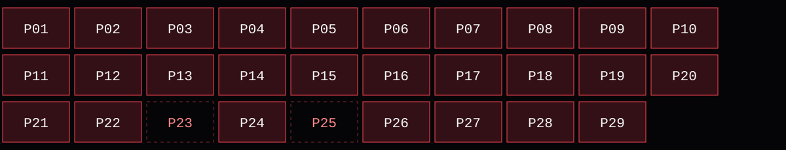
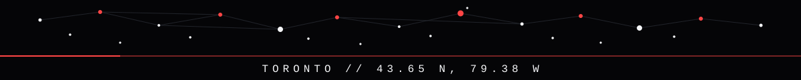

AI engineer in Toronto. Production ML, retrieval and agent orchestration, each built as a measured study.

## The question

How far can we trust the judge?

That is the question under this work. The research spine is evaluation reliability: whether the scores that decisions rest on deserve the trust placed in them. The roadmap below asks that question twenty-nine ways, in the open.

## The roadmap

Twenty-nine projects, one method: a research question, pre-registered hypotheses, measured results, and a published verdict. Learn, Build, Deepen, in that order. A filled cell is a project at v1.0.

<picture>
  <source media="(prefers-color-scheme: dark)" srcset="assets/ledger-dark.svg">
  <source media="(prefers-color-scheme: light)" srcset="assets/ledger-light.svg">
  
</picture>

<!--PROFILE:ROADMAP-->
26 of 29 projects at v1.0.
<!--/PROFILE:ROADMAP-->

## Measured results

Six studies, with the figures as published in their own repositories.

| Study | Result |
| :--- | :--- |
| [vector-systems-benchmark](https://github.com/JesunAhmadUshno/vector-systems-benchmark) | Three vector backends over 58,999 chunks. Unfiltered recall@10: FAISS 0.967, pgvector 0.978, Qdrant 1.000. Under a filter near 1 percent selectivity, FAISS falls to 0.413 and pgvector holds 1.000. |
| [experimentation-lab](https://github.com/JesunAhmadUshno/experimentation-lab) | Verdict: CONFIRMED. Question headlines reduce click-through: pooled odds ratio 0.8645, 95% CI 0.8335 to 0.8966, from a locked confirmatory run on the Upworthy archive. |
| [terraform-for-ai-infrastructure](https://github.com/JesunAhmadUshno/terraform-for-ai-infrastructure) | 13 of 13 plan equivalence across OpenTofu and Terraform. Drift detection recall 0.7037, against a naive baseline of 0.1667. |
| [langgraph-vs-native-study](https://github.com/JesunAhmadUshno/langgraph-vs-native-study) | A framework against a native loop on identical tasks. Pass rate 0.979 in both arms. 48 of 48 fault runs recovered exactly once in both arms. |
| [rag-eval-harness](https://github.com/JesunAhmadUshno/rag-eval-harness) | A RAG evaluation harness whose judge is checked against human labels. [Live dashboard](https://jesunahmadushno.github.io/rag-eval-harness). |
| [credit-risk-lab](https://github.com/JesunAhmadUshno/credit-risk-lab) | Credit risk modelling for fair access to credit in Canada. [Live dashboard](https://jesunahmadushno.github.io/credit-risk-lab). |

## Research

Two papers, AIP Conference Proceedings, 2023.

- An elitist particle swarm optimization with mutation operator and adaptive inertia weight for global optimization. [doi:10.1063/5.0148658](https://doi.org/10.1063/5.0148658)
- Designing an autonomous framework to detect and classify the fabric defects using wavelet transform and neural network. [doi:10.1063/5.0148618](https://doi.org/10.1063/5.0148618)

ORCID: [0000-0002-6070-9025](https://orcid.org/0000-0002-6070-9025)

## Record

- MSc Data Analytics, University of Niagara Falls Canada, 2026. Graduated with distinction, CGPA 3.9154.
- AI Engineer and Data Specialist, Gallea Ai, Toronto.
- IT Advisory, KPMG Bangladesh, Officer to Consultant. ISO 27001 audit work.

## Contribution

<!--PROFILE:CONTRIBUTION-->
84 public repositories. 156 merged pull requests.
<!--/PROFILE:CONTRIBUTION-->

## Contact

[jesunahmadushno.com](https://jesunahmadushno.com) · [LinkedIn](https://www.linkedin.com/in/jesunahmadushno) · [ORCID](https://orcid.org/0000-0002-6070-9025)

<!--PROFILE:PROVENANCE-->
Panels regenerated on 2026-11-07 by the [profile workflow](.github/workflows/profile.yml). Counts are read from GitHub by that workflow, never typed by hand.
<!--/PROFILE:PROVENANCE-->

